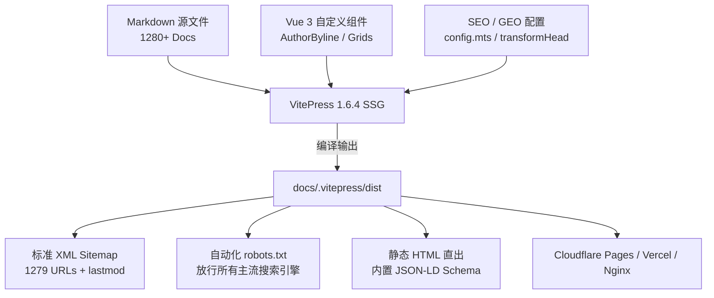

<div align="center">

# 🌐 ainetguide.cc

### 跨境网络、4K 流媒体解锁与 AI 办公全球选型全景知识库
**A Comprehensive Knowledge Base & Technical Blueprint for Cross-Border Networking, Streaming & AI Workspace**

[](https://vitepress.dev/)
[](https://vuejs.org/)
[](https://vitejs.dev/)
[](#-知识图谱与专题矩阵)
[](#-seo--aeo--geo-技术规范)
[](LICENSE)

[🌐 访问在线知识库](https://ainetguide.cc/) • [📖 快速启动](#-快速启动) • [🗺️ 架构图谱](#-架构设计与目录规范) • [⚡ 性能与技术栈](#-核心技术架构)

</div>

---

## 📌 项目定位与愿景

**ainetguide.cc** 是一个面向**企业出海、跨国远程协同、AI 深度办公及 4K 极清流媒体**的行业级知识图谱与技术选型知识大系。

项目由网络工程架构团队（CCIE #49281 执笔）打造，彻底破除网络服务领域信息不对称。全站拒绝机械采集与空泛宣传，采用 **Answer-First（答案优先）** 策略，整合多线物理拓扑测速、协议逆向解析、防跑路风险预警与高可用分流规则，构建严密可验证的主题权威性（Topical Authority）。

> [!NOTE]
> 本知识库已实现全站 1,280+ 静态 HTML 页面深度预渲染，全面支持 Bing、Google、百度、神马（yisouspider）自然搜索及 ChatGPT、Perplexity、Google AI Overviews、Claude 等 AI 问答系统的实体索引与直接引用。

---

## ✨ 核心特性矩阵

| 维度 | 核心特性说明 |
| :--- | :--- |
| **🚀 顶尖静态性能** | 基于 **VitePress 1.6.4** 驱动，首屏 100% 静态 HTML 极速直出，客户端按需动态水合，支持极速明暗主题切换与全键盘快捷搜索。 |
| **🛡️ 权威 E-E-A-T 体系** | 落地完整信任基石（评测方法论 v2.4、独立作者团队、数据溯源规范、隐私政策与合规免责声明），全站内嵌实体专家卡片。 |
| **🤖 GEO / AEO 深度适配** | 结构化 Answer-First 论证逻辑、统一数据统计口径、64 个细分场景故障排查与报文分析，为 AI 搜索引擎提供高置信度实体引用源。 |
| **📐 扁平化蜂巢内链** | 严格贯彻「点击深度 ≤ 3」原则，Pillar Hub 顶层导航贯穿 64 个二级专题与 1,024 篇实战长尾文章，形成坚不可摧的主题集群（Topic Cluster）。 |
| **📊 全量 Schema.org 知识图谱** | 全站注入 `WebSite`、`Organization`、`CollectionPage`、`Article` 以及 42 家服务商真实评分的 `Product` + `Review` 富媒体结构化数据。 |

---

## 🗺️ 知识图谱与专题矩阵

本项目由 **9 大 Pillar Hub（顶层柱心枢纽）** 与 **64 个细分实战集群** 构成网状协同知识体系：

```
ainetguide.cc (Index Hub)
│
├── 🛡️ VPN推荐与专线选型 (/vpn/)
│   ├── 企业物理专线 (IPLC/IEPL) 架构
│   └── 传统 VPN 与现代代理解密对比
│
├── ⚡ 机场推荐与避坑全书 (/jichang/)
│   ├── 42 家主流跨境服务商 SLA 履约大表
│   └── 晚高峰丢包压测与防跑路双轨对冲方案
│
├── ⚙️ Clash / 客户端全景实战 (/clash/)
│   ├── Clash Verge Rev / Clash Meta / FlClash 实战
│   └── TUN 虚拟网卡全流量接管与 DNS 防泄露配置
│
├── 🌍 全球节点与线路选型 (/nodes/)
│   ├── 香港 / 日本 / 美国 / 新加坡等核心区域评测
│   └── BGP Anycast 多线与专线出口实测延迟
│
├── 🪜 梯子选型决策指南 (/tizi/)
│   └── 按需匹配：AI开发 / 外贸电商 / 学术科研 / 4K流媒体
│
├── ⚠️ 免费资源与安全解剖 (/free/)
│   ├── 公开节点中间人攻击（MITM）与凭据劫持溯源
│   └── 钓鱼订阅防范与 1 元合规应急替代方案
│
├── 📚 客户端与排障教程库 (/tutorial/)
│   └── 分流规则编写、Wireshark 握手捕获与多平台互联
│
└── 🏢 全球服务商独立品牌库 (/brands/)
    └── 42 份独立深度实测档案、解锁测试与节点监控
```

---

## 🛠️ 核心技术架构



- **静态站点生成器**：VitePress 1.6.4
- **前端视图框架**：Vue 3.4+ / Vite 5
- **路由策略**：`cleanUrls: true`（消除 `.html` 伪静态后缀，提升 URL 语义美观度）
- **类型支持**：TypeScript
- **结构化数据**：JSON-LD `@graph` 动态注水（支持 BreadcrumbList、Article、Product、Review）

---

## ⚡ 快速启动

### 1. 环境准备
确保您的本地环境已安装 **Node.js 18.0.0+** 及包管理器：
```bash
node -v   # 建议 v20.x 或以上
npm -v
```

### 2. 克隆仓库
```bash
git clone https://github.com/abcabc98698-dev/ainetguide.cc.git
cd ainetguide.cc
```

### 3. 安装依赖
```bash
npm install
```

### 4. 本地启动开发服务器
```bash
npm run docs:dev
```
本地服务启动后，在浏览器中访问：`http://localhost:5173/`

### 5. 生产环境构建与检查
```bash
# 静态全量构建（通常耗时 40~50s，生成 1280 个 HTML 页面）
npm run docs:build

# 本地预览生产构建产物
npm run docs:preview
```

---

## 🔍 SEO / AEO / GEO 技术规范

本站点在构建时遵循严密的国际搜索引擎工程规范：

1. **唯一正式域名声明**：全站所有资源与引用严格绑定唯一主域 `https://ainetguide.cc/`。
2. **Canonical 自引用规范**：
   - 目录与枢纽页面输出：`https://ainetguide.cc/slug/`（带尾斜杠）
   - 长尾末端页面输出：`https://ainetguide.cc/path/slug`（无尾斜杠）
   - 彻底避免由于斜杠混用导致的权重稀释。
3. **爬虫友好型 robots.txt**：
   - 显式声明放行：`Googlebot`、`Bingbot`、`Baiduspider`、`yisouspider`、`Sogou`、`360Spider`、`PerplexityBot`、`ClaudeBot`。
   - 关联官方 Sitemap 地址：`https://ainetguide.cc/sitemap.xml`。
4. **高质量 XML Sitemap**：
   - 自动收录 1,279 条正式内容，排除所有 404 及私有草稿页面；
   - 自动注入精准的 `<lastmod>` 统计时间戳、更新频次与抓取权重。
5. **站长平台预留验证槽位**：
   - 在 [`docs/.vitepress/config.mts`](docs/.vitepress/config.mts) 中预设了 Google、Bing、神马与百度的 Meta 标签插入位，支持无损秒级挂载。

---

## 📁 目录结构导览

```text
ainetguide.cc/
├── docs/                       # 核心文档与文章内容源目录
│   ├── .vitepress/             # VitePress 站点核心配置
│   │   ├── config.mts          # 站点路由、SEO、Head、Schema 与构建配置
│   │   ├── theme/              # 自定义主题扩展与组件
│   │   │   ├── components/     # 专家作者卡片等 Vue 组件
│   │   │   └── index.ts        # 主题入口挂载
│   │   └── dist/               # 生产构建生成的静态文件 (git 忽略)
│   ├── public/                 # 静态资源 (robots.txt, 图标, 媒体文件)
│   ├── vpn/                    # VPN 核心 Pillar Hub 与二级栏目
│   ├── jichang/                # 机场推荐 Pillar Hub 与二级栏目
│   ├── clash/                  # Clash 专题指南
│   ├── nodes/                  # 全球节点技术大系
│   ├── tizi/                   # 梯子选型决策指南
│   ├── free/                   # 免费与低成本网络安全指南
│   ├── tutorial/               # 客户端排障与配置教程库
│   ├── brands/                 # 42 家服务商独立实测品牌库
│   ├── about.md                # E-E-A-T: 关于我们
│   ├── methodology.md          # E-E-A-T: 评测方法论 v2.4
│   ├── privacy.md              # E-E-A-T: 隐私保护政策
│   ├── terms.md                # E-E-A-T: 服务条款与免责声明
│   ├── author.md               # E-E-A-T: 专家团队档案
│   ├── 404.md                  # 自定义 SEO 友好型 404 页面
│   └── index.md                # 知识库顶级万字 Pillar 首页
├── scripts/                    # 自动化审计、内链诊断与构建验证工具
├── tracking/                   # 知识图谱登记表、实体库与进度矩阵
├── .gitignore                  # Git 忽略配置
├── package.json                # 项目依赖与构建脚本
├── tsconfig.json               # TypeScript 基础配置
└── README.md                   # 项目综合自述文档
```

---

## 🚀 部署指引

### 推荐部署方案：Cloudflare Pages / Vercel

1. 将本代码仓库推送至 GitHub；
2. 登录 **Cloudflare Dashboard** -> **Workers & Pages** -> **Create application** -> **Pages** -> **Connect to Git**；
3. 选择 `ainetguide.cc` 仓库并配置构建参数：
   - **Framework Preset**：`VitePress`
   - **Build command**：`npm run docs:build`
   - **Build output directory**：`docs/.vitepress/dist`
   - **Node.js Version**：`>= 18`
4. 绑定自定义域名 `ainetguide.cc`，并在 DNS 设置中将 `www.ainetguide.cc` 301 重定向至主域名。

---

## 🤝 贡献与参与

欢迎网络工程师、安全研究者和开源爱好者参与完善知识库：

1. **Fork** 本仓库；
2. 新建特性分支 (`git checkout -b feature/AmazingGuide`)；
3. 遵循评测方法论撰写客观严谨的技术内容，提交代码 (`git commit -m 'Add some AmazingGuide'`)；
4. 推送到分支 (`git push origin feature/AmazingGuide`)；
5. 发起 **Pull Request**。

---

## 📄 免责声明与合规

本仓库包含的技术方案、评测数据及配置说明仅供**计算机网络学术研究、跨国企业合规办公、外贸技术支持及软件开发调试**使用。请使用者严格遵守所在地法律法规，不得利用相关技术从事任何违法违规活动。

---

<div align="center">

**© 2026 ainetguide.cc Technical Team. All Rights Reserved.**  
Crafted with ❤️ for Cross-Border Builders & AI Pioneers.

</div>
